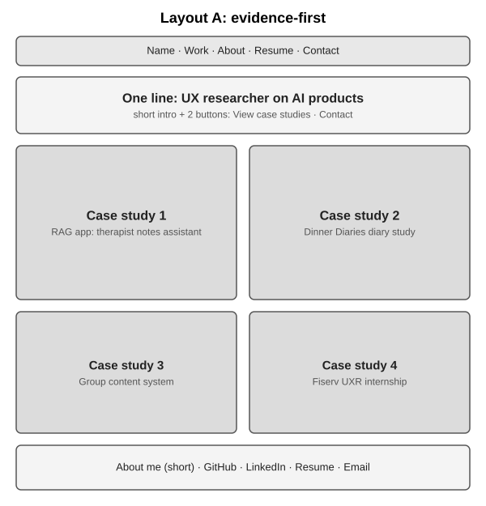
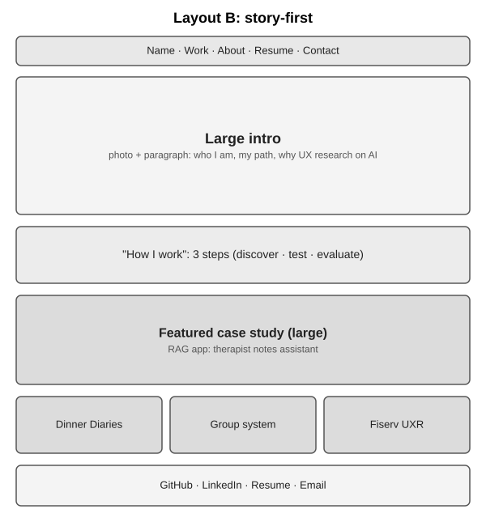

# 1. Individual portfolio + career research

**Product:** my hosted professional portfolio website. **Research:** career research that decides the site's reader, content, design and featured work.

[Back to index](README.md)

## Changed / checked / next

### Build (Nov 23)

- **Changed:** built and hosted the portfolio foundation at [mcbridgeee.github.io/is373-portfolio](https://mcbridgeee.github.io/is373-portfolio/) ([repository](https://github.com/mcbridgeee/is373-portfolio)). It has my introduction and direction (UX research for AI products), navigation, Throughline and the group project labeled "in progress," my four existing research projects linking to their full case studies, and my résumé, LinkedIn, GitHub and email. I kept Layout B and hosted it as a static page on GitHub Pages instead of my DigitalOcean server; the reasons are under [hosting and style decisions](#hosting-and-style-decisions).
- **Career finding that shaped the site:** the two AI-focused postings, the Google FDE internship (P1) and the ServiceNow UX research internship (P2), both ask for checking AI output against its source data. Because that is the skill I most want a hiring manager to see, the intro names UX research for AI products as my direction and Throughline, an AI app I'm evaluating against its own sources, is the first featured project.
- **Checked:** HTML validates and every local link, image and anchor exists (observed locally and in CI on [PR #2](https://github.com/mcbridgeee/is373-portfolio/pull/2)). At 375 px wide there is no sideways scrolling, Tab reaches every link in order with a visible focus outline, and text contrast is at least 8:1 (observed locally, Nov 23). The live page loads with its résumé, images and every link responding (observed hosted, Nov 23). Peer checks are still planned.
- **Next (Checked Release, Dec 3):** write the Throughline case study with its evaluation result, write the group case study naming my contribution, add a one-line finding under each research project, give Throughline a demo that doesn't need a sign-in, and update my résumé. The peer test and retest follow at Improve (Dec 10).

### Plan (Nov 16)

- **Changed:** recorded three employer postings across three role families (FDE, UX research on AI, product management); compared UX research and PM; chose UX research on AI products as my provisional direction and a UX research hiring manager as my reader; mapped responsibilities to evidence; outlined the portfolio; chose story-first Layout B.
- **Checked:** opened all three original postings on 2026-11-15 and confirmed they were live, with eligibility and qualifications recorded from the employer pages.
- **Next:** build the portfolio foundation by Build (Nov 24): intro, direction, navigation and case study placeholders labeled as in progress.

## Employer posting records

Requirement: three original employer postings, at least two role families, FDE included as a reference. Include an internship or junior posting if I can verify one. Senior roles show skills to build, not what I qualify for now.

| # | Employer / title | Role family | Level | How I'm using it |
| --- | --- | --- | --- | --- |
| P1 | Google, Forward Deployed Engineering Intern | Forward deployed engineering | Internship | Near-term stretch; FDE reference |
| P2 | ServiceNow, UX Research Internships | UX research on AI products | Internship (Master's) | Reference; not eligible now |
| P3 | Duolingo, Senior Product Manager, Learning | Product management | Senior, full-time | Long-term reference |

### Posting 1: FDE reference

| Field | Record |
| --- | --- |
| Employer / exact title | Google · Forward Deployed Engineering Intern, BS/MS, Summer 2027 |
| Role family | Forward deployed engineering |
| Original URL | https://www.google.com/about/careers/applications/jobs/results/75665705386549958-forward-deployed-engineering-intern-bsms-summer-2027 |
| Date checked | 2026-11-15 (open) |
| Posted date / deadline | Posted date not shown · apply before **Nov 20, 2026** · rolling review |
| Location / work arrangement / travel | Choice of Sunnyvale CA, **New York NY**, Reston VA · 12 weeks full-time · travel not stated |
| Level and eligibility | Internship. Penultimate-year BS/MS student in Engineering, CS or a related technical field; in the US for the whole internship |
| Responsibility 1 | Build AI applications for Google's enterprise customers, taking prototypes to production-ready agent workflows (multi-agent systems, MCP servers). |
| Responsibility 2 | Connect Google's AI products to each customer's real systems: APIs, older data, and security boundaries. |
| Responsibility 3 | Build evaluation and monitoring tools that check AI accuracy, safety and speed, and turn repeated customer problems into reusable modules or product feature requests. |
| Required qualifications | Python (or similar) development; taking production AI solutions from concept to launch; designing AI systems on cloud platforms (e.g. GCP); building data pipelines with vector databases and RAG-like architectures |
| Preferred qualifications | Multi-agent frameworks (LangGraph, CrewAI, ADK); leading technical discovery sessions; LLM metrics (tokens/sec, cost per request); tracing and state management |
| Short excerpt supporting my reading (section name) | Responsibilities: "Create evaluation pipelines and observability tools" for accuracy, safety and latency; the role is an "embedded builder" alongside customer engineering teams. |
| Something I have actually done | Deployed apps on my own DigitalOcean server with Docker, Traefik, HTTPS and CI/CD; built a FastAPI app with login and member/admin roles (IS373 Studios); built an AI chat tool during my Fiserv internship |
| One gap | No production AI system yet; no RAG or vector-database pipeline |
| Next action and date | Build and evaluate my IS373 RAG app; working hosted version by 2026-11-24 |
| Uncertainty / not stated | Whether HCI counts as "a related technical field"; travel; posting date. Pay listed as $98K–$131K (annualized) |

### Posting 2: UX research on AI products

| Field | Record |
| --- | --- |
| Employer / exact title | ServiceNow · Experience Team – UX Research Internships – Summer 2027 |
| Role family | UX research on AI products |
| Original URL | https://careers.servicenow.com/jobs/744000157919529/experience-team-ux-research-internships-summer-2027/ |
| Date checked | 2026-11-15 (Apply button active) |
| Posted date / deadline | Page shows Oct 26, 2026 (not labeled as posted or deadline) · deadline not stated |
| Location / work arrangement / travel | Listed San Diego, "Flexible or Remote"; also hires Santa Clara CA, West Palm Beach FL · 12 weeks full-time · $45.97–$53.04/hr |
| Level and eligibility | Internship. **Master's** students in HCI, Human Factors, Cognitive Psych or related, graduating May 2028 or later. **I am not eligible now** (BS, Dec 2027): reference posting |
| Responsibility 1 | Plan, run, analyze and report research studies from early discovery through design validation, representing customer and end-user needs. |
| Responsibility 2 | Turn findings into artifacts (personas, journey maps, task analyses) and support iterative usability testing, working with senior UX staff to inform product strategy and roadmaps. |
| Responsibility 3 | Use AI-assisted workflows for study planning, transcript analysis and synthesis (checking AI output against the source data), and help evaluate and improve AI-enabled research tools and measure their effect on team efficiency. |
| Required qualifications | Not split into required vs preferred. Clearly mandatory: full-time for 12 weeks; portfolio at interview stage. Listed: experience using or critically evaluating AI in work or coursework; writing and running surveys and qualitative research; usability evaluation, task analysis, experimental design |
| Preferred qualifications | Not labeled. Also listed: customer-facing experience; learning technical concepts quickly |
| Short excerpt supporting my reading (section name) | Team: "Our team uses AI across the research lifecycle, from planning and synthesis to reporting." |
| Something I have actually done | UX research internship at Fiserv; Dinner Diaries diary study. Strong in qualitative research |
| One gap | Requires a Master's degree |
| Next action and date | Finish my portfolio site and update it with my most recent work by 2027-01-01 |
| Uncertainty / not stated | Required vs preferred not labeled; exact deadline; which team/location I'd join |

### Posting 3: Product management

| Field | Record |
| --- | --- |
| Employer / exact title | Duolingo · Senior Product Manager, Learning |
| Role family | Product management |
| Original URL | https://careers.duolingo.com/jobs/8827944002 |
| Date checked | 2026-11-15 (open; listing updated 2026-11-02) |
| Posted date / deadline | Not stated |
| Location / work arrangement / travel | New York NY or Pittsburgh PA · arrangement and travel not stated · base $182,800–$247,300 plus equity |
| Level and eligibility | **Senior**, full-time; asks for "experience generating outstanding results as a product manager." Long-term direction, not current eligibility |
| Responsibility 1 | Own a part of the language-learning experience (features like Stories, DuoRadio, Video Call), driving features from idea and spec through development, release, analysis and iteration. |
| Responsibility 2 | Run qualitative and quantitative research to explore and validate feature ideas, then analyze experiments to find what to improve. |
| Responsibility 3 | Set the strategy for that focus area and align engineers, designers, cross-functional partners and leadership around it. |
| Required qualifications | Not split. "You have": PM experience with outstanding results; using user insights, data and statistics for decisions; "top-tier design sense"; resourceful, curious, innovative; desire to improve the world through education tech |
| Preferred qualifications | None listed separately |
| Short excerpt supporting my reading (section name) | You will: "Perform qualitative and quantitative research to explore and validate feature ideas." |
| Something I have actually done | Dinner Diaries diary study used to shape design decisions; planned and coordinated group projects, assigning tasks and keeping the team on schedule |
| One gap | Senior role that requires prior product management experience (no degree requirement listed). No junior PM role open at Duolingo for my level right now; the only PM internship listed is for MBA students |
| Next action and date | Check Duolingo and similar edtech companies for associate or junior PM roles that fit my graduation date by 2027-01-01 |
| Uncertainty / not stated | No direct AI mention in the posting text; work arrangement; deadline |

## Comparing two directions

| Question | Direction A: UX research on AI products (P2, with P1 as technical context) | Direction B: Product management (P3) |
| --- | --- | --- |
| What would I do regularly? (from the postings) | Plan, run and synthesize studies from discovery to validation; turn findings into personas, journey maps and task analyses; evaluate AI-enabled tools and workflows | Own a product area end to end; prioritize features and run experiments; set strategy and align engineering, design and leadership |
| What attracts me or feels unsuitable? | Being an individual contributor who conducts research directly, understands users, and shapes what gets built and why. Solving new problems and influencing how a product develops | Research informs decisions but is not the main daily work; the focus is prioritization and business tradeoffs across many teams. Early in my career I want to build hands-on research depth first |
| What can I demonstrate today? (real links) | Fiserv UX research internship; Dinner Diaries diary study; strong qualitative research | Coordinating group projects: assigning tasks and keeping teams on schedule; research-informed design decisions |
| Which gap can this course help with? | Evaluating AI systems: my RAG app's evaluation (expected evidence, citation support, missing-evidence answers) is a research study of an AI tool | Running and analyzing experiments; defining requirements and scope for a shipped feature |
| Next step and date | Finish and update my portfolio with my most recent research by 2027-01-01 | Look for associate PM roles that fit my graduation date by 2027-01-01 |

**Provisional choice and why:** UX research on AI products. It matches the work I want to do every day as an individual contributor: running research, understanding users, and shaping product decisions with evidence. Product management uses many of the same skills, and my project coordination experience transfers, but its center is prioritization and strategy rather than research. I'll keep PM as a possible later direction.

(The full private reflection, about 150 to 250 words, stays in Canvas, not in this public repo.)

## Target role and reader

- **Target role (provisional):** UX researcher on AI products (internship or junior)
- **Primary reader:** a UX research hiring manager or recruiter on a team building AI products
- **After visiting my site, this reader should understand / do:** that I run rigorous qualitative research and can also evaluate an AI system's answers against evidence, then open one case study and contact me

## Responsibility-to-evidence map

| Employer responsibility (posting #) | Evidence I can show | Exists now or planned? |
| --- | --- | --- |
| Plan, run and synthesize research from discovery to validation (P2) | Fiserv UX research internship; Dinner Diaries diary study | Exists |
| Evaluate AI-enabled tools and check AI output against source data (P2); build evaluation tools for accuracy and safety (P1) | RAG app evaluation: five questions with expected sources, citation checks, missing-evidence answers, peer test and retest | Planned (Build Nov 24, Release Dec 3) |
| Build AI applications and connect them to real systems (P1) | RAG app hosted on my own server with Docker, Traefik, HTTPS and CI/CD; AI chat tool built at Fiserv | Server and CI exist; RAG app planned |
| Align a team and keep shared work on track (P3) | Group content system: task owners, reviewers and my named contribution | Planned (group project) |

## Portfolio page outline

Required content: accurate introduction, individual RAG case study with a link to the working app, group case study naming my own contribution, code/demo links, resume / GitHub / LinkedIn links, and a professional contact route. Public pages must work without making a recruiter create an account.

**Hosted URL:** [mcbridgeee.github.io/is373-portfolio](https://mcbridgeee.github.io/is373-portfolio/) (observed hosted, Nov 23). The Plan stage proposed portfolio.bmctiernan.com on my DigitalOcean server; see the decision below.

1. **Home:** one-line direction (UX researcher on AI products), short intro, links to case studies and contact.
2. **RAG app case study:** problem and reader, research and architecture choice, evaluation results, what I changed after peer testing, link to the working app and code. Under the title, one line saying what I evaluated and what I found, written only after the checks run (placeholder: "I tested whether the app's answers were supported by the sessions they cited: [result]"). From Dhruvi's feedback ([#1](https://github.com/mcbridgeee/is373-individual-planning/issues/1)).
3. **Group system case study:** the problem, our workflow, and my named contribution with links.
4. **Research case studies:** Dinner Diaries diary study; Fiserv UX research internship (only what I'm allowed to share). Each gets the same one-line "what I tested and what I found" under its title, so a skimming hiring manager sees the research before opening it.
5. **About, resume, GitHub, LinkedIn and email.**

## Two lightweight layouts

Same content, two treatments. Wireframes only; I do not build two sites.

| | Layout A: evidence-first | Layout B: story-first |
| --- | --- | --- |
| Wireframe |  |  |
| What the reader sees first | One-line direction, then a grid of four case studies | A large intro about me and my path, then how I work, then one featured case study |
| Strength | A busy reviewer reaches work in one click; every project gets equal weight | Explains my non-traditional path and research process; puts the RAG app in front |
| Weakness | Less personality; my story is pushed down to a short About | Case studies sit lower, so a skimming reviewer may leave before seeing work |

**Choice and reason:** Layout B (story-first), provisional; I'll revisit it after peer feedback at Build. My reader is a UX research hiring manager. In a field where so much is now AI-generated, I want to come across as a real, personable human: who I am, what I care about, how I work, and why I chose this path. B leads with that, then puts my most recent and best work (the RAG case study) front and center. **Trade-off I'm accepting:** case studies sit lower than in Layout A, so a fast skimmer might leave before seeing work. **Check:** at the peer test, see whether a reviewer reaches a case study without help; if not, move the featured project higher.

## Hosting and style decisions

- **Hosting:** the course brief suggests reusing my FastAPI app, brand, server and CI where suitable. I compared reusing my App Studio FastAPI app on my DigitalOcean server with a static page on GitHub Pages. Because the portfolio is public content with no accounts or data, FastAPI would add login code and a server deploy the site doesn't need, so I chose the static page and kept CI (HTML and link checks on every pull request). **Trade-off:** the site isn't on my own domain yet; I can point a subdomain at it later.
- **Style:** I considered a Windows XP desktop theme and set it aside for now, because draggable windows are hard to make work at phone width and with a keyboard. I chose a neo-brutalist look (thick borders, flat bright colors, bold type), which keeps the personality Layout B is meant to show while scoring high on contrast. **Check:** the peer test will show whether the style helps or distracts.

## Checks

| Check | Expected result | Status |
| --- | --- | --- |
| Peer can name my target role from the homepage without help | Says "UX research on AI products" within about 30 seconds | planned (Dec 10) |
| Peer can find evidence of one skill | Opens a case study that shows a research method and its result | planned (Dec 10) |
| Peer can open a featured project | Reaches the RAG case study from the homepage in one or two clicks | planned (Dec 10) |
| Keyboard navigation reaches every link | Tab reaches every link and button in order, with a visible focus outline | observed locally, Nov 23 |
| Readable at phone width | No sideways scrolling and readable text at 375 px wide | observed locally, Nov 23 |
| Text contrast | At least 4.5:1 for all text | observed locally, Nov 23 (lowest 8:1) |
| HTML and links | Valid HTML; every local link, image and anchor exists | observed in CI, Nov 23 |
| Live site and links load | Page, résumé, images and outside links respond | observed hosted, Nov 23 |

## Help received

- AI: Claude helped me find and verify current postings, summarize their responsibilities, draft the comparison wording and draw the layout wireframes. I checked the postings myself and made the direction, reader and layout decisions.
- AI (Build): Claude helped me build the page and set up CI and GitHub Pages hosting. The content comes from my existing portfolio and this research, and I chose the direction, the style and the featured projects.
- People: Dhruvi reviewed my portfolio plan ([#1](https://github.com/mcbridgeee/is373-individual-planning/issues/1)); a peer test of the live site is planned for Improve.
